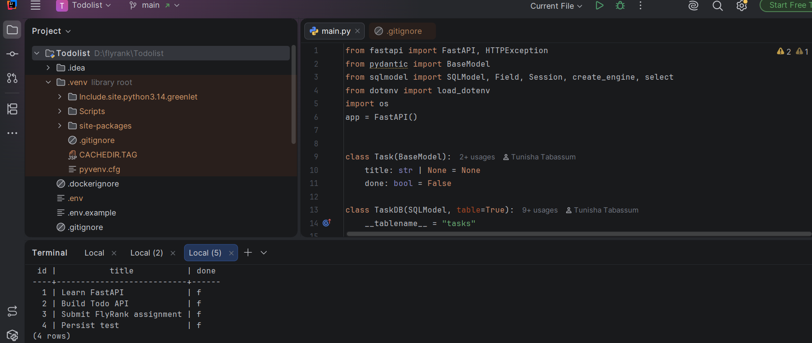

# FlyRank Todo API
A task API built with FastAPI, SQLModel and PostgreSQL, running in Docker. One command starts the API and its database.
## Run everything
```
cp .env.example .env
docker compose up
```

On Windows PowerShell use `Copy-Item .env.example .env` instead of `cp`. Then open http://localhost:8000/docs.
## Variables
Set these in `.env` (see `.env.example`):
- `DATABASE_URL` - connection string used when running the API outside Docker
- `POSTGRES_PASSWORD` - the database password (also used by `compose.yaml`)
Tasks are stored in a Docker volume, so they survive `docker compose down` and `up`. Never use `docker compose down -v` unless you want to wipe the data.
## Endpoints
| Method | Path | Description | Success | Errors |
|--------|------|-------------|---------|--------|
| GET | /tasks | List all tasks | 200 | - |
| GET | /tasks/{id} | Get one task | 200 | 404 |
| POST | /tasks | Create a task | 201 | 400 |
| PUT | /tasks/{id} | Update a task | 200 | 400, 404 |
| DELETE | /tasks/{id} | Delete a task | 204 | 404 |
## Example: curl -i for an unknown id
```
HTTP/1.1 404 Not Found
date: Sat, 17 Oct 2026 16:53:21 GMT
server: uvicorn
content-length: 37
content-type: application/json

{"detail":{"error":"Task not found"}}
```
## Data in the database


---

## Previous assignment: A2 (SQLite)

# Todo API

A simple Todo CRUD API built with FastAPI and SQLite.

# Swagger UI


#### curl -i Output

Request:

```bash
curl.exe -i http://127.0.0.1:8000/tasks
```

Response:

```text
HTTP/1.1 200 OK
date: Thu, 01 Oct 2026 11:04:55 GMT
server: uvicorn
content-length: 198
content-type: application/json

[{"id":1,"title":"Learn FastAPI","done":false},{"id":2,"title":"Build Todo API","done":false},{"id":3,"title":"Submit FlyRank assignment","done":false},{"id":4,"title":"A1 submission","done":false}]
```

## Database

The API uses SQLite to store tasks instead of keeping them only in memory.

SQLite was chosen because it is lightweight and does not require a separate database server, which makes it suitable for this small Todo API.

The database is stored locally as:

`tasks.db`

The `tasks` table contains:

* `id` - integer primary key
* `title` - task title
* `done` - task completion status

The database and table are created automatically when the application starts. Three example tasks are inserted only when the table is empty.

## Example SQL

View all tasks:

```sql
SELECT * FROM tasks;
```

Update a task:

```sql
UPDATE tasks
SET done = 1
WHERE id = 1;
```

Delete a task:

```sql
DELETE FROM tasks
WHERE id = 1;
```

The database was manually inspected using DB Browser for SQLite, and the CRUD operations were tested through Swagger UI. Data was also verified to persist after restarting the application.

## Run

```bash
pip install "fastapi[standard]" sqlmodel
fastapi dev main.py
```

Swagger UI:

`http://127.0.0.1:8000/docs`

## API Endpoints

* `GET /tasks` - Get all tasks
* `GET /tasks/{task_id}` - Get a task by ID
* `POST /tasks` - Create a task
* `PUT /tasks/{task_id}` - Update a task
* `DELETE /tasks/{task_id}` - Delete a task

